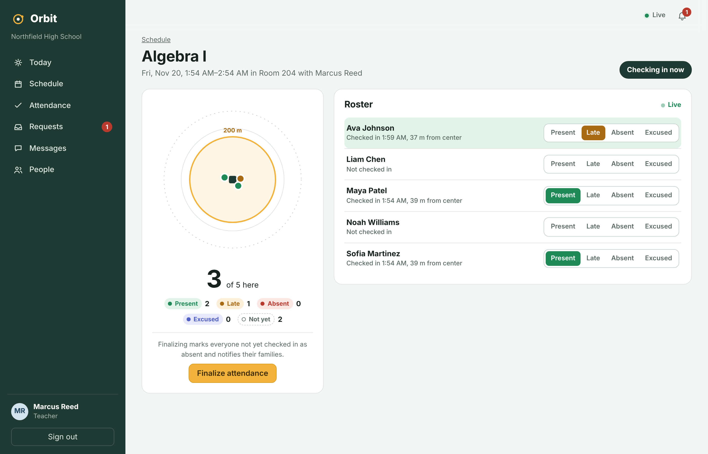
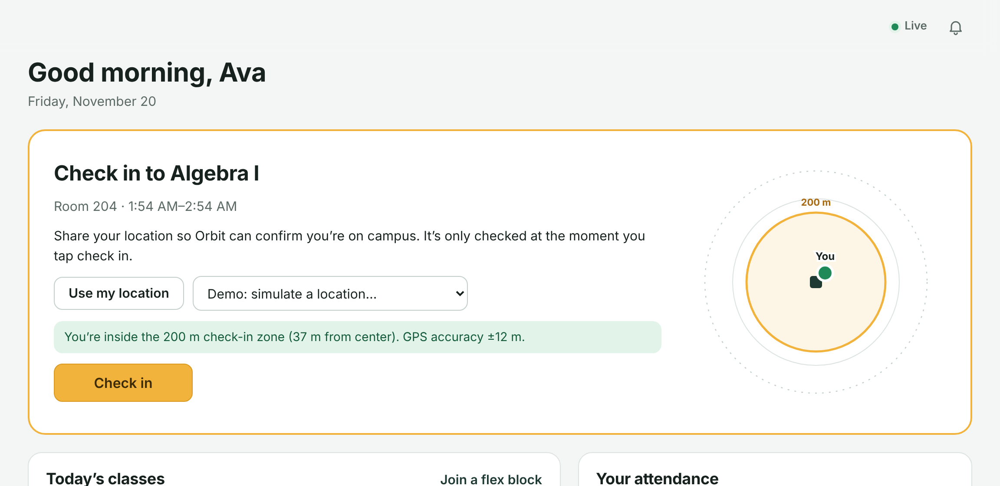
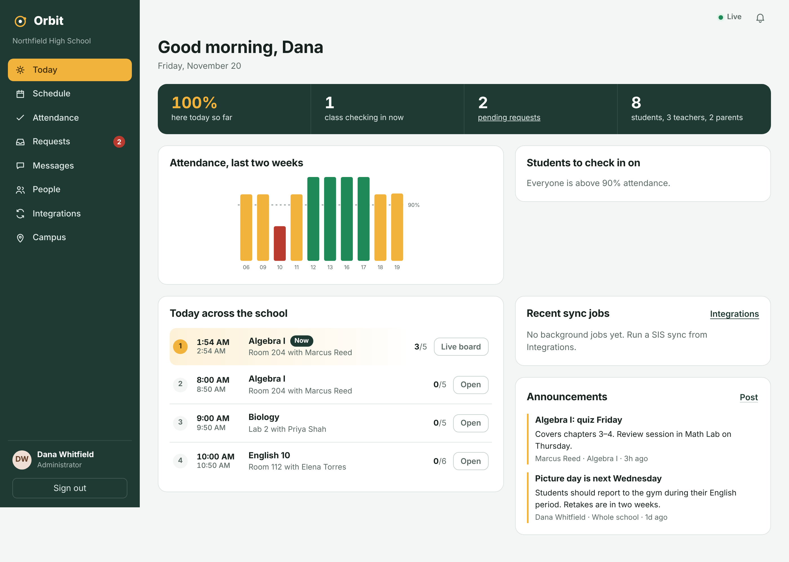
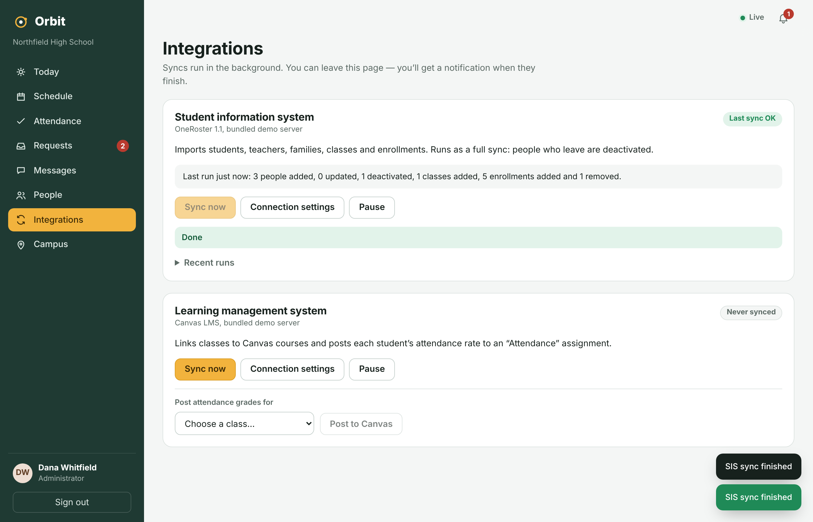
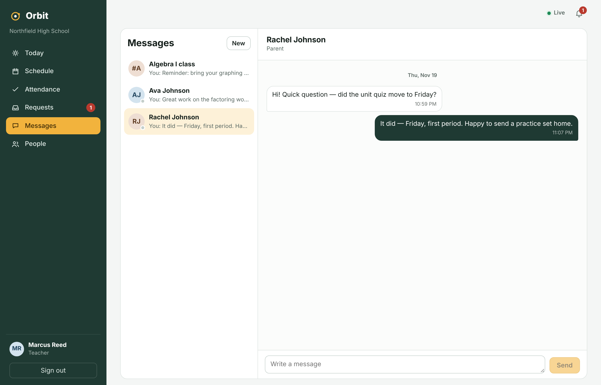
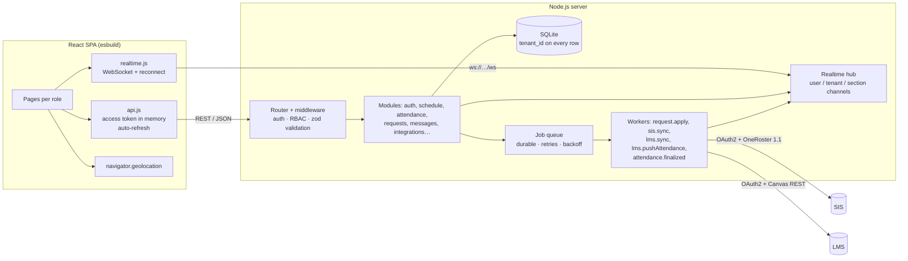

# Orbit

**Real-time attendance, scheduling and communication for schools.** A full-stack web app (React + Node.js) where students check in to class with their phone's location, teachers watch the roster fill in live, families get notified the moment something matters, and everything stays in sync with the school's student information system (SIS) and learning management system (LMS).



| | |
|---|---|
|  |  |
|  |  |

---

## What it does

| Capability | How Orbit does it | Where to look |
|---|---|---|
| **Attendance** | Students check in from their phone; the server verifies enrollment, the check-in window, GPS accuracy and the campus geofence. Teachers can mark or correct by hand, then *finalize*, which marks everyone else absent and notifies families. | `server/modules/attendance.js` |
| **Scheduling** | Sections, one-off and weekly recurring sessions in each school's own time zone (DST-safe), "start a class now", and conflict detection for double-booked teachers, rooms and sections. | `server/modules/schedule.js` |
| **Real-time communication** | A WebSocket hub pushes check-ins to live boards, delivers messages and typing indicators, tracks who's online, and streams background job progress. | `server/realtime/hub.js`, `client/src/realtime.js` |
| **SIS integration** | OneRoster 1.1 REST client (the roster standard behind PowerSchool, Infinite Campus, Skyward, Clever…): OAuth2 client credentials, paging, idempotent upserts by `sourcedId`, full-sync semantics (withdrawn students are deactivated). | `server/integrations/oneroster.js` |
| **LMS integration** | Canvas LMS REST client: links courses and people by `sis_course_id` / `sis_user_id`, follows `Link`-header pagination, and posts each student's attendance rate to an "Attendance" assignment through the Submissions API. | `server/integrations/canvas.js` |
| **Geolocation services** | Haversine distance, circular campus geofences with GPS-drift tolerance, an accuracy floor, a live "how far am I" preview, and an admin geofence editor. | `server/lib/geo.js`, `client/src/Orbit.jsx` |
| **Asynchronous request workflows** | Students request to join flex blocks; parents submit absence excuses. Approvals return `202 Accepted` and are applied by a durable, database-backed job queue with retries and exponential backoff; every transition is audited and pushed live. | `server/modules/requests.js`, `server/jobs/queue.js` |
| **JWT auth + RBAC (4 roles)** | HS256 access tokens (15 min, memory only) plus rotating refresh tokens in an httpOnly cookie with reuse detection. Admin, teacher, student and parent permissions, plus data-level scoping (a teacher only sees their sections, a parent only their children). | `server/modules/auth.js`, `server/lib/rbac.js` |
| **Multi-tenant** | Every row carries `tenant_id`; the tenant comes from the verified token, never from the client. Rows in another school return `404`, and WebSocket channels are assigned by the server so events can't leak between schools. | `server/db/schema.sql`, `tests/api/rbac-tenancy.test.js` |

### What each role sees

- **Administrators:** a school-wide pulse (who's here now, pending requests), a two-week attendance trend, students below 90%, every live class, people management (activate SIS-imported accounts, link families), SIS/LMS sync controls and the campus geofence.
- **Teachers:** their day as a bell schedule, a live board per class (the orbit ring fills as students arrive), one-tap marking, finalize, flex-block approvals, class announcements and messages.
- **Students:** a check-in card when class is open, today's classes with their status, their attendance rate, flex-block requests and messages with their teachers.
- **Parents:** each child's day and attendance rate, absence excuses, absence/late notifications and messages with their children's teachers.

---

## Quick start

Requires **Node.js 22.13 or newer** (Orbit uses Node's built-in SQLite).

```bash
npm install
npm run build      # bundle the React app
npm start          # http://localhost:4000
```

The first start loads two demo schools. Use the demo buttons on the sign-in page, or:

| School code | Role | Email | Password |
|---|---|---|---|
| `northfield` | Administrator | admin@northfield.test | `orbit123` |
| `northfield` | Teacher | m.reed@northfield.test | `orbit123` |
| `northfield` | Student | ava@northfield.test | `orbit123` |
| `northfield` | Parent | rachel.johnson@northfield.test | `orbit123` |
| `riverside` | Administrator | admin@riverside.test | `orbit123` |

**Try this:** open the teacher (Marcus Reed) in one window and the student (Ava) in a private window. As Ava, pick *Demo: simulate a location → In the building* and press **Check in**. Ava appears on Mr. Reed's live board instantly. Then try *At home* to see the geofence refuse it. As the admin, open **Integrations → Sync now** to import three new students and a new class from the bundled OneRoster server.

> The seed creates a class that is "live" for an hour from when the database was created. To demo check-in later, either run `npm run seed` to reset the data, or sign in as a teacher and use **Schedule → Start a class now**.

Development mode with auto-rebuild and auto-restart: `npm run dev`.

---

## Architecture



- **Frontend:** React 19 bundled by esbuild into hashed static assets, a small history-API router and no UI framework. All times render in the school's time zone.
- **Backend:** Node's `http` module with a small Express-style router (`server/lib/router.js`), `ws` for WebSockets, `zod` for input validation and `node:sqlite` for storage. JWT signing and scrypt hashing come from `node:crypto`, so the server has only two runtime dependencies.
- **Data:** a single shared schema with `tenant_id` on every table, plus composite uniqueness such as `(tenant_id, email)` so the same address can exist in two districts.

### Asynchronous request workflow

```
 pending ──approve──▶ approved ──(background job)──▶ completed
    │                                    └─────────▶ failed   (e.g. flex block filled meanwhile)
    ├──deny────▶ denied
    └──cancel──▶ cancelled (requester only)
```

Approving returns **202 Accepted** with a job id. The job runs out-of-band (enrolling the student, or marking every class that day excused without overwriting real presence), records an audit event, notifies the people involved, and pushes `request.updated` and `job.updated` over the WebSocket. Integration syncs work the same way: `POST /api/integrations/sis/sync` returns `202` with a `Location: /api/jobs/:id` header.

### Check-in rules

A check-in is accepted only if **all** of these hold, checked on the server:

1. The student is enrolled in the section, and the session is not finalized or cancelled.
2. Now is between 10 minutes before the start and the end of class.
3. GPS accuracy is ±100 m or better.
4. The fix is inside the campus geofence. Edge drift is forgiven up to `min(accuracy, 30 m)`.

More than 5 minutes after the start counts as **late**. Repeated taps are idempotent, a check-in overrides an earlier teacher "absent", and excused or present records are never downgraded.

### Real-time protocol

```jsonc
// client → server (first frame, within 5 s)
{ "type": "auth", "token": "<access JWT>" }
// server → client
{ "type": "ready", "data": { "user": {…}, "online": ["userId", …] } }
// teacher/admin live board
{ "type": "subscribe", "channel": "section:<id>" }   // authorized server-side
{ "type": "typing", "conversationId": "<id>" }        // relayed to members only
// pushed events
attendance.updated · session.updated · message.created · typing · presence
request.updated · job.updated · notification · announcement.created
```

### Roles and permissions

| Permission | Admin | Teacher | Student | Parent |
|---|:-:|:-:|:-:|:-:|
| Manage users, sections, campus geofence, integrations | ✓ | | | |
| Create/edit sessions, mark & finalize attendance | ✓ | own sections | | |
| Decide requests | ✓ | when approver | | |
| Post announcements | whole school | own sections | | |
| Check in with location | | | ✓ | |
| Create requests | | | flex-block joins | absence excuses |
| View attendance | everyone | own sections | self | own children |
| Message | anyone | staff + their students & families | their teachers & office | their children's teachers & office |

---

## API overview

All endpoints are under `/api`, take and return JSON, and (except auth/config) need `Authorization: Bearer <token>`. Errors look like `{ "error": { "code", "message", "details" } }`.

| Area | Endpoints |
|---|---|
| Auth | `POST /auth/login`, `POST /auth/refresh`, `POST /auth/logout`, `GET /auth/me`, `POST /auth/change-password` |
| Dashboard | `GET /dashboard` (shape depends on role), `GET /config`, `GET /health` |
| Scheduling | `GET/POST /sections`, `GET/PATCH /sections/:id`, `POST/DELETE /sections/:id/enrollments[/:studentId]`, `GET/POST /sessions`, `POST /sessions/recurring`, `PATCH /sessions/:id`, `POST /sections/:id/sessions/start`, `GET /schedule/conflicts` |
| Attendance | `POST /attendance/check-in`, `PUT /sessions/:id/attendance`, `POST /sessions/:id/finalize` (202), `GET /attendance`, `GET /attendance/summary` |
| Geolocation | `GET /campuses`, `POST/PATCH /campuses/:id`, `GET /geo/check?latitude&longitude&accuracy` |
| Requests | `GET/POST /requests`, `GET /requests/:id`, `POST /requests/:id/decision` (202 on approve), `POST /requests/:id/cancel` |
| Messaging | `GET /messages/contacts`, `GET/POST /conversations`, `GET/POST /conversations/:id/messages`, `POST /conversations/:id/read`, `GET/POST /announcements`, `GET /notifications`, `POST /notifications/:id/read`, `POST /notifications/read-all` |
| People | `GET/POST /users`, `PATCH /users/:id`, `POST /users/:id/reset-password`, `POST /guardianships`, `DELETE /guardianships/:parentId/:studentId` |
| Integrations | `GET /integrations`, `PATCH /integrations/:kind`, `POST /integrations/:kind/sync` (202), `POST /integrations/lms/push-attendance` (202), `GET /jobs`, `GET /jobs/:id` |

---

## Testing

```bash
npm test                         # unit + API integration tests
npx playwright install chromium  # once
npm run test:e2e                 # real-browser end-to-end tests
```

**130 tests** across three layers. Each API and e2e file boots its own server on a random port with a fresh in-memory database.

- **Unit (17):** JWT (tampering, `alg:none`, expiry, issuer/audience), haversine and geofence edges, scrypt, DST-aware time-zone math, rate limiter, Link-header parsing, attendance-rate math.
- **API (98):**
  - auth: refresh rotation, reuse detection, logout, deactivation, rate limiting, security headers, path traversal
  - a permission matrix for all four roles, plus tenant isolation: cross-school ids → 404, forged tenant claims → 401, list endpoints never leak
  - scheduling conflicts (section/teacher/room) and recurring sessions across a DST change
  - every check-in rule
  - the full request lifecycle, including the "block filled up after approval" failure path
  - messaging policy
  - SIS sync: idempotency, credential rejection without retries, unreachable-server retries with backoff
  - Canvas pagination and grade passback verified against what the LMS received
  - WebSocket auth, delivery, subscriptions and cross-school isolation
- **End-to-end (15, Playwright):**
  - a student checks in using the browser's real Geolocation API while the teacher's board updates with no reload
  - off-campus and weak-GPS refusals
  - finalize
  - live messaging between two browsers
  - approving a flex request and watching it complete on the student's screen
  - a SIS sync from the UI
  - recurring scheduling with clash handling
  - a sweep of every page for every role, plus the phone layout

CI runs all three on every push (`.github/workflows/ci.yml`).

---

## Configuration

Set these in the environment or in a `.env` file (see `.env.example`).

| Variable | Default | Purpose |
|---|---|---|
| `PORT` | `4000` | HTTP + WebSocket port |
| `JWT_SECRET` | random per boot (dev) | **Required in production.** Signs access tokens. |
| `ACCESS_TOKEN_TTL` / `REFRESH_TOKEN_TTL` | `900` / `604800` | Token lifetimes in seconds |
| `DB_FILE` | `./data/orbit.db` | SQLite database path |
| `DEMO_MODE` | `true` unless `NODE_ENV=production` | Loads demo schools, shows the location simulator, serves the mock SIS/LMS |
| `PUBLIC_URL` | — | Public origin, used to reach bundled mock providers behind a proxy |
| `LOG_LEVEL` | `info` | `debug`, `info`, `warn`, `error` or `silent` |

### Going to production

```bash
docker build -t orbit .
docker run -p 4000:4000 -v orbit-data:/data -e JWT_SECRET="$(openssl rand -hex 32)" orbit
# create a real school and its first admin
docker exec -it <container> node scripts/create-tenant.js --slug lincoln --name "Lincoln High" \
  --timezone America/Chicago --admin-email principal@lincoln.org --admin-name "Jo Park" --lat 41.88 --lng -87.63
```

Then sign in as that admin and point **Integrations** at your real OneRoster endpoint and Canvas instance (`https://…`, client ID and secret).

### Scaling notes

The code is organized so the single-node pieces can be swapped without touching the feature modules:

- **Database:** move SQLite to PostgreSQL. The `tenant_id` columns map directly onto Postgres row-level security policies.
- **Real-time fan-out:** run the WebSocket hub behind Redis pub/sub so `publish()` reaches clients on every instance.
- **Background jobs:** the queue already claims jobs atomically (`UPDATE … RETURNING`) and recovers stalled jobs on boot. For several workers, back it with Postgres `SKIP LOCKED`, BullMQ or SQS.
- **Rate limiting:** the login rate limiter is in-memory per process. Use Redis for a shared limit.

### Security notes

- Passwords are hashed with scrypt, and login uses constant-time comparisons with a dummy hash for unknown accounts.
- Access tokens live only in memory. Refresh tokens are httpOnly, `SameSite=Strict` and scoped to `/api/auth`. They rotate on every use, and only their SHA-256 hash is stored.
- Security headers: CSP, `X-Frame-Options: DENY`, `nosniff`, `Referrer-Policy` and a `Permissions-Policy` allowing geolocation for this origin only.
- Request bodies are validated with zod, and every SQL query is parameterized.
- Location is only read when a student taps **Use my location**, and only the check-in coordinates are stored. GPS can be spoofed by a determined user. The accuracy floor, check-in window, teacher review on the live board and audit trail make that visible rather than impossible.

---

## Project structure

```
server/
  app.js, index.js          HTTP server, static hosting, startup/shutdown
  config.js                 environment configuration
  db/                       schema.sql, SQLite helpers, demo fixtures + seed
  lib/                      router, http helpers, jwt, password, geo, time, rbac, validation
  middleware/               authentication, permissions, rate limiting
  modules/                  auth, users, campuses, schedule, attendance, requests,
                            messages, announcements, notifications, integrations, dashboard
  jobs/queue.js             durable job queue
  realtime/hub.js           WebSocket hub
  integrations/             OAuth2 API client, OneRoster + Canvas adapters, mock providers
client/
  src/                      React app: pages per feature, realtime + api clients, orbit visual
scripts/                    build, dev, create-tenant, screenshots
tests/                      unit/, api/, e2e/
```

## License

[MIT](LICENSE)
